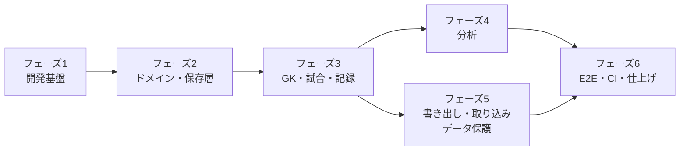
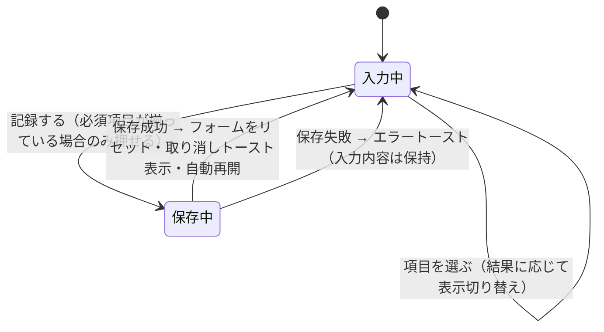

# 初回実装 設計

- 作業ディレクトリ: `.steering/20260928-initial-implementation/`
- 作成日: 2026-09-28
- ステータス: 承認済み（2026-09-28）
- 前提: [requirements.md](./requirements.md)（承認済み）

---

## 1. 実装アプローチ

### 1.1 方針

- **内側から外側へ作る**。ドメイン層 → データ保存層 → プレーヤー制御 → 画面の順に実装し、下の層はテストで固めてから上の層で使う
- **縦に1本通すことを優先する**。フェーズ3で「GK登録 → 試合登録 → 記録」が一通り動く状態を作り、そのあと分析・書き出しを足す
- 設計・命名・配置は docs/ に従い、本書では **今回の実装で具体的に決めること** だけを書く

### 1.2 フェーズ



| フェーズ | 内容 | 終了条件 |
|---|---|---|
| 1 開発基盤 | プロジェクト作成、Tailwind・ESLint・Prettier・Vitest・Playwright 設定、テーマ、レイアウトとルーティングの骨組み | 空の5画面を行き来でき、lint・typecheck・test・build が通る |
| 2 ドメイン・保存層 | 列挙値、Zodスキーマ、検証、YouTube URL 解析、集計、Dexie 定義、Repository | 単体テストが通り、`domain/` のカバレッジ 90% 以上 |
| 3 GK・試合・記録 | SC1・SC2・M1・M2、プレーヤー制御、SC3（入力パネル・シュート一覧・取り消し） | 実際の YouTube 動画で1試合分の記録ができる |
| 4 分析 | SC4（絞り込み・ヒートマップ・シーン一覧）、M3（1シーン再生） | 記録したデータで弱点コースを確認できる |
| 5 書き出し・取り込み、データ保護 | JSON 書き出し・取り込み、SC5、バックアップ警告、永続化の要求 | 書き出し → 取り込みで復元できる |
| 6 E2E・CI・仕上げ | E2E テスト、GitHub Actions、vercel.json、README、画面サイズ・ダーク表示の確認 | requirements.md 4章の受け入れ条件をすべて満たす |

---

## 2. 作成するコンポーネント・モジュール

今回はすべて新規作成。配置は repository-structure.md 2章に従う。今回の範囲外（`crossTable.ts`、`playlist.ts`、`exportCsv.ts`、`CourtZoneMap.tsx`、`CrossTable.tsx`、`useKeyboardShortcuts.ts`）は作らない。

### 2.1 ドメイン層（`src/domain/`）

| ファイル | 公開する主なもの |
|---|---|
| `enums.ts` | `shotZones`, `shotResults`, `shotTypes`, `goalkeeperActions`, `handednesses`, `shooterPositions`, `situations`, `goalCells` と各 `〜Labels`、`onTargetResults`（`['goal', 'save']`） |
| `schemas.ts` | `goalkeeperSchema`, `matchSchema`, `matchGoalkeeperSchema`, `shotSchema`, `settingsSchema`, `exportFileSchema` |
| `types.ts` | `Goalkeeper`, `Match`, `MatchGoalkeeper`, `Shot`, `Settings`, `ExportFile`（`z.infer` で生成） |
| `validation.ts` | `validateShotInput(input): Result<ShotInput, ShotValidationError[]>`、`isGoalCellRequired(result)`, `isGoalCellAllowed(result)`, `isGoalkeeperActionAllowed(result)` |
| `youtube.ts` | `parseYouTubeVideoId(url): Result<string, 'invalid_url'>` |
| `stats/filter.ts` | `FilterCriteria` 型、`emptyFilterCriteria`、`applyFilter(shots, criteria, matches)` |
| `stats/metrics.ts` | `calcMetrics(shots): Metrics`（シュート本数・枠内・失点・セーブ・セーブ率・失点率） |
| `stats/heatmap.ts` | `buildGoalHeatmap(shots, lowSampleThreshold): Record<GoalCell, HeatmapCell>` |
| `transfer/exportJson.ts` | `buildExportFile(data, scope): ExportFile` |
| `transfer/importJson.ts` | `parseImportFile(text): Result<ExportFile, ImportError>`、`detectConflicts(file, existingIds)`、`checkReferences(file, existing)` |
| `transfer/migrations.ts` | `migrateExportFile(raw)`（今回は version 1 のみ。枠組みだけ作る） |

**型の要点**

```ts
// stats/filter.ts
export type FilterCriteria = {
  matchIds: string[];           // 空 = 対象GKの全試合
  zones: ShotZone[];
  goalCells: GoalCell[];
  shotTypes: ShotType[];
  results: ShotResult[];
  shooterHands: Handedness[];
  shooterPositions: ShooterPosition[];
  situations: Situation[];
  halves: Half[];
};

// stats/metrics.ts
export type Metrics = {
  shotCount: number;
  onTargetCount: number;
  goalCount: number;
  saveCount: number;
  saveRate: number | undefined;  // 枠内0本なら undefined
  goalRate: number | undefined;
};

// stats/heatmap.ts
export type HeatmapCell = Metrics & { isLowSample: boolean };
```

- 試合の絞り込みは、ストアには **除外した試合のID** を保存し、分析画面で「対象GKの全試合 − 除外した試合」を計算して `matchIds` に渡す。こうすると、あとから追加した試合は自動で集計対象に入る（2.4参照）

### 2.2 データ保存層（`src/db/`）

**Dexie の定義（`database.ts`）**

```ts
export class AppDatabase extends Dexie {
  goalkeepers!: Table<Goalkeeper, string>;
  matches!: Table<Match, string>;
  matchGoalkeepers!: Table<MatchGoalkeeper, [string, string]>;
  shots!: Table<Shot, string>;
  settings!: Table<Settings & { key: 'app' }, 'app'>;

  constructor(name = 'handball_analysis') {
    super(name);
    this.version(1).stores({
      goalkeepers: 'id, teamName',
      matches: 'id, date',
      matchGoalkeepers: '[matchId+goalkeeperId], goalkeeperId, matchId',
      shots: 'id, matchId, goalkeeperId, [matchId+videoTime]',
      settings: 'key',
    });
  }
}
```

- `matchGoalkeepers` に `matchId` のインデックスも追加する（試合削除時の連動削除で使う。functional-design.md 6.4 からの追加）
- テストでは `new AppDatabase('test-' + id)` と fake-indexeddb で独立したDBを使う

**Repository**

| ファイル | 主な関数 |
|---|---|
| `goalkeeperRepository.ts` | `list()`, `get(id)`, `save(input)`, `delete(id)`（Shot・MatchGoalkeeper を連動削除）, `countRelated(id)` |
| `matchRepository.ts` | `listByGoalkeeper(goalkeeperId)`, `get(id)`, `save(input, goalkeeperIds)`（紐づけの差分更新。担当シュートがあるGKの解除は拒否）, `delete(id)`, `countRelated(id)` |
| `shotRepository.ts` | `listByMatch(matchId)`, `listByGoalkeeper(goalkeeperId)`, `save(input)`, `delete(id)`, `restore(shot)`（取り消し用） |
| `settingsRepository.ts` | `get()`（未保存なら既定値）, `update(partial)` |
| `dataTransferService.ts` | `exportAll()`, `exportGoalkeeper(id)`, `exportMatch(id)`, `previewImport(file)`, `importFile(file, onConflict)` |

- 複数ストアにまたがる削除・取り込みは `db.transaction('rw', [...], fn)` で1トランザクションにする
- `save` は `id` がなければ新規（`createdAt` を付与）、あれば更新（`updatedAt` を更新）とし、保存前に Zod で検証する

### 2.3 プレーヤー制御（`src/player/`）

```ts
// player/types.ts
export type PlayerState = 'unstarted' | 'playing' | 'paused' | 'buffering' | 'ended';
export type PlayerError = 'invalid_video' | 'not_found' | 'embed_not_allowed' | 'unknown';

export interface VideoPlayer {
  play(): void;
  pause(): void;
  seekTo(seconds: number): void;
  getCurrentTime(): number;
  getDuration(): number;
  setPlaybackRate(rate: number): void;
  loadVideo(params: { videoId: string; start?: number; end?: number; autoplay?: boolean }): void;
  onStateChange(listener: (state: PlayerState) => void): () => void;
  onError(listener: (error: PlayerError) => void): () => void;
  destroy(): void;
}
```

- YouTube のエラーコードの対応: `2` → `invalid_video`、`100` → `not_found`、`101` / `150` → `embed_not_allowed`、それ以外 → `unknown`
- `loadYouTubeApi()` は Promise を返し、スクリプトの読み込みを1回に限る
- 埋め込みホストは `https://www.youtube-nocookie.com`、`playerVars` は `{ rel: 0, playsinline: 1, modestbranding: 1 }`
- `useVideoPlayer` は現在時刻を 250ms ごとに取得して、「記録する」ボタンの時刻表示に使う（再生中のみ）

**埋め込み可否の確認（M2 試合登録）**

1. URL を `parseYouTubeVideoId` で解析（失敗したらその場でエラー表示）
2. モーダル内の小さなプレーヤーで `loadVideo({ videoId, autoplay: false })`
3. `onError` で `embed_not_allowed` / `not_found` を受け取ったら保存ボタンを無効にしてメッセージを表示。3秒以内にエラーがなく、読み込みが完了（`unstarted` / `paused` などの状態通知）すれば保存可能

### 2.4 状態管理（`src/stores/`）

| ストア | 状態 | 永続化 |
|---|---|---|
| `useAnalysisFilterStore` | `byGoalkeeper: Record<goalkeeperId, { criteria: Omit<FilterCriteria, 'matchIds'>; excludedMatchIds: string[]; metric: 'saveRate' \| 'goalRate' \| 'shotCount' }>` | `localStorage`（Zustand の `persist`） |
| `useShotFormStore` | `lastGoalkeeperIdByMatch: Record<matchId, string>`, `lastHalf`, `isDetailOpen` | `localStorage` |

- 絞り込み条件は利用者の作業状態であり、失われても致命的ではないため `localStorage` に置く（IndexedDB の業務データとは分ける）
- 入力中のシュート（フォームの値）はストアに入れず、`ShotForm` の中の state で持つ

### 2.5 画面・コンポーネント

| 画面 | 主な実装内容 |
|---|---|
| SC1 `GoalkeeperListPage` | チームごとのグループ表示（チーム名の昇順）、検索（チーム名・GK名の部分一致）、GKごとの試合数・シュート数、`BackupReminder` |
| SC2 `GoalkeeperDetailPage` | GK情報、合計指標（`calcMetrics`）、試合一覧（日付の降順、試合ごとの本数）、試合の追加・編集・削除 |
| SC3 `RecordPage` | 左に `YouTubePlayer`・`PlayerControls`・`ShotList`、右に `ShotForm`。`?shot=` があればそのシュートを編集状態で開き、その時刻にシーク |
| SC4 `AnalysisPage` | 左に `FilterPanel`、中央に `GoalHeatmap`（指標の切り替え付き）と対象の件数、右に `SceneList`。シーンを押すと `HighlightPlayerModal` を1シーン再生で開く |
| SC5 `SettingsPage` | 書き出し（全データ）、取り込み（プレビュー → 上書き/スキップ選択 → 実行）、設定値の編集、保存容量の表示 |
| M1 `GoalkeeperForm` / M2 `MatchForm` | `Modal` 上のフォーム。Zod スキーマで検証し、エラーを項目の下に表示 |
| M3 `HighlightPlayerModal` | 今回は1シーン再生のみ。`loadVideo({ videoId, start: t - pre, end: t + post, autoplay: true })`、シーン情報を表示。「もう一度」「閉じる」 |

GK単位・試合単位の書き出しは、SC2 の GK情報のメニューと試合行のメニューに置く。

**ShotForm の入力の流れ**



- 結果を「枠外」「DFブロック」に変えたとき、入力済みのコース・GKの対応は消す（V4）。「セーブ」以外に変えたときは GKの対応を消す（V5）
- 編集モードでは「記録する」を「更新する」にし、動画時刻の±0.5秒ボタンと「現在の再生位置で上書き」ボタンを表示する

**CourtZonePicker のコート図**

- SVG の `viewBox="0 0 400 300"` で、攻撃方向を上（ゴールが上）にした半面コートを描く
- ゾーンは6mライン・9mラインと角度で分けた領域として、次の形で定義する（`CourtZoneShape.tsx`）
    - 6m ライン内側付近: `pivot_l` / `pivot_c` / `pivot_r`
    - 6m〜9m の外側: `lw` / `lb` / `cb` / `rb` / `rw`
- 7mスロー・速攻・ロングシュートはコート図の下に独立したボタンとして置く（場所より状況を優先するため。glossary.md 3.1）

**GoalGrid / GoalHeatmap**

- 3×3 の CSS グリッド。各セルに「コース番号」「本数」「指標の値」を表示
- 色は `heat-0`〜`heat-5` の6段階。指標の値を6段階に区切って割り当てる（`saveRate` / `goalRate` は 0〜1 を等分、`shotCount` は最大値を基準に等分）
- 参考値のセルは斜線の背景と「参考」ラベル。枠内0本のセルは「−」

---

## 3. データ構造

### 3.1 保存データ

functional-design.md 6章のとおり。今回の実装で決める詳細は次のとおり。

| 項目 | 決定 |
|---|---|
| ID | `crypto.randomUUID()` |
| 日時（`createdAt` など） | ISO 8601 文字列（UTC）。`new Date().toISOString()` |
| 試合の `date` | `YYYY-MM-DD` 文字列（タイムゾーンを持たない） |
| `videoTime` | 秒。保存時に小数第1位に丸める |
| 任意項目 | 未入力はプロパティを持たない（`undefined`）。IndexedDB に `null` を保存しない |
| 設定 | 未保存の場合は既定値（functional-design.md 6.3）を返す。`key: 'app'` の1件として保存 |

### 3.2 localStorage に置くもの

| キー | 内容 |
|---|---|
| `handball_analysis.analysisFilter` | `useAnalysisFilterStore` の状態（バージョン番号付き） |
| `handball_analysis.shotForm` | `useShotFormStore` の状態（バージョン番号付き） |

GK・試合を削除したとき、対応する絞り込み条件・直前選択は残っていても害がないため、削除時には触れない（参照先がないIDは無視する）。

### 3.3 docs/ への影響

| ドキュメント | 変更 |
|---|---|
| functional-design.md 6.4 | `matchGoalkeepers` に `matchId` インデックスを追加（連動削除の効率のため） |

実装前に functional-design.md を更新する（本書の承認をもって docs/ の更新も承認されたものとする）。上記以外に docs/ の設計変更はない。

---

## 4. テスト設計

### 4.1 単体テスト（Vitest）

| 対象 | 主なケース |
|---|---|
| `validation.ts` | V1〜V7 の各ルール、結果ごとのコース・GK対応の必須/可否 |
| `youtube.ts` | functional-design.md 5.6 の5形式、`t=` などの余分なパラメータ、11文字でないID、YouTube 以外のURL |
| `stats/metrics.ts` | 枠内0本、ポスト・枠外・ブロックを分母から除く、丸めなしの値 |
| `stats/filter.ts` | 項目内OR・項目間AND、空の条件は全件、試合の除外 |
| `stats/heatmap.ts` | コースなしのシュートを除外、参考値の判定、9セルすべてが返る |
| `transfer/*` | 書き出し → 取り込みで同じデータ、不正な JSON・スキーマ違反・未対応 `schemaVersion` の拒否、重複検出、参照整合性 |
| Repository | 保存・更新（日時の付与）、連動削除、担当シュートがあるGKの紐づけ解除の拒否、取り込みのトランザクション（途中失敗で全件ロールバック） |
| 性能 | 1万件のダミーデータで `applyFilter` + `buildGoalHeatmap` が 100ms 以内 |

### 4.2 コンポーネントテスト（Testing Library）

- `ShotForm`: 必須項目が揃うまで「記録する」が無効、結果による入力欄の切り替え、保存後のリセットと担当GKの保持
- `GoalHeatmap`: 値と参考値の表示、セルのタップで `onCellSelect` が呼ばれる
- `FilterPanel`: 条件の変更がストアに反映される

### 4.3 E2E テスト（Playwright）

| ファイル | 流れ |
|---|---|
| `e2e/record-and-analyze.spec.ts` | GK登録 → 試合登録 → シュートを3本記録（うち1本を取り消し）→ 分析画面でヒートマップの値を確認 → 絞り込み → シーン再生のモーダルが開く |
| `e2e/export-import.spec.ts` | データ作成 → 全データ書き出し → データを消去 → 取り込み → 同じ内容が表示される。不正ファイルでエラー |

- YouTube プレーヤーのモック: E2E 用のビルドでは、`window.__E2E_VIDEO_PLAYER__` が定義されていればそれを `VideoPlayer` として使う（Playwright の `addInitScript` で注入）。本番ビルドでもこの分岐は残るが、外部から設定される値ではないため害はない
- 画面サイズは 1024×768（iPad 横向き相当）で実行する

---

## 5. CI・公開の設定

### 5.1 GitHub Actions（`.github/workflows/ci.yml`）

- トリガー: すべてのブランチへの push、Pull Request
- ジョブ `check`: `npm ci` → `lint` → `typecheck` → `test -- --coverage` → `build`
- ジョブ `e2e`（`check` の後）: Playwright のブラウザ（chromium, webkit）をインストール → `test:e2e`。失敗時はレポートを成果物として保存
- Node.js は 24、npm のキャッシュを使う

### 5.2 Vercel（`vercel.json`）

- `rewrites`: すべてのパスを `/index.html` へ
- `headers`: architecture.md 4章の CSP、`X-Content-Type-Options: nosniff`、`Referrer-Policy: strict-origin-when-cross-origin`、`Permissions-Policy`（カメラ・マイク・位置情報を無効）
- README に「Vercel で GitHub リポジトリを Import → Framework Preset: Vite → デプロイ」の手順を書く

---

## 6. 影響範囲とリスク

新規のプロジェクトのため、既存のコードへの影響はない。

| リスク | 影響 | 対策 |
|---|---|---|
| YouTube IFrame API の状態通知がブラウザで異なる（特に iPad の Safari） | 埋め込み可否の判定・時刻取得がずれる | フェーズ3で実機（iPad）確認を行う。判定は「エラー通知の有無」を主とし、状態通知には依存しすぎない |
| 動画を読み込む前に `getCurrentTime()` を呼ぶと 0 や例外になる | 誤った時刻で記録される | プレーヤーの準備完了まで「記録する」を無効にする |
| Safari のデータ削除 | 記録データの消失 | 2.2 のバックアップ警告・永続化の要求。PWA は次回 |
| TypeScript 7・Vite 8 など新しいメジャーバージョンと周辺プラグインの相性 | 設定でつまずく | フェーズ1で先に確認し、問題があれば1つ前のメジャーバージョンに下げ、architecture.md の更新を提案する |
| E2E のプレーヤーのモック | 実際の YouTube との差を見逃す | 手動確認のチェックリスト（tasklist.md）で実動画での確認を必須にする |
