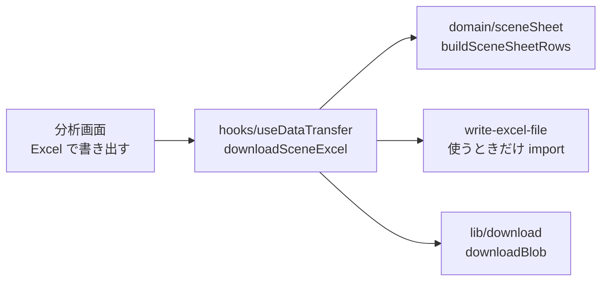

# シーン一覧の Excel 書き出し 設計

- 作業ディレクトリ: `.steering/20261003-scene-excel-export/`
- 作成日: 2026-10-03
- ステータス: 承認済み（2026-10-03、利用者の「PR まで作成して」の指示により、PR のレビューで確認する）
- 前提: [requirements.md](./requirements.md)（承認済み）

---

## 1. 実装アプローチ

一覧の行（文字列）を作る処理はドメイン層の純粋関数にして単体テストで網羅し、.xlsx への変換は `write-excel-file` に任せる。



## 2. 一覧の行（domain/sceneSheet.ts）

```ts
export const SCENE_SHEET_HEADERS = ['シュート種別', '動画開始時間', '動画終了時間'] as const;
export type SceneSheetRow = { shotType: string; start: string; end: string };
export function buildSceneSheetRows(params: { shots: readonly Shot[]; preSeconds: number; postSeconds: number }): SceneSheetRow[];
export function buildSceneSheetFileName(goalkeeperName: string, localDate: string): string;
// → handball_analysis_scenes_{GK名}_{YYYYMMDD}.xlsx
```

- シュート種別: `shotTypeLabels`（用語集と同じ）。未入力は空文字
- 動画開始時間: `formatVideoTime(max(0, 記録時刻 − 前余白))`、動画終了時間: `formatVideoTime(記録時刻 + 後余白)`（`m:ss`、1時間以上は `h:mm:ss`。秒未満は切り捨て）
- 並び順は渡されたまま（シーン一覧と同じ）

## 3. .xlsx の作成（hooks/useDataTransfer.ts）

```ts
export async function downloadSceneExcel(params: { goalkeeper: Goalkeeper; shots: readonly Shot[]; preSeconds: number; postSeconds: number }): Promise<void>;
```

- `write-excel-file/browser` を `import()` で遅延読み込みする（初回表示の JS に含めない）
- シート名「シーン」、1行目は見出し（太字）、`stickyRowsCount: 1` で見出しを固定、列の幅は 16・14・14
- 時間は文字列のセルにする（Excel が時刻の数値に変換しないように）
- 作った Blob を `lib/download.ts` の `downloadBlob` でダウンロードする（`downloadTextFile` も `downloadBlob` を使うように整理する）

## 4. 画面

- 分析画面の右列「シーン（n件）」の見出しの横に「Excel で書き出す」ボタン（見出しの文字は変えない）。0件のときは無効
- 成功したら「n件のシーンを Excel に書き出しました」、失敗したら「書き出せませんでした。もう一度お試しください。」のトースト

## 5. 変更するファイル

| ファイル | 変更 |
|---|---|
| `src/domain/sceneSheet.ts` | 新規（行・見出し・ファイル名） |
| `src/lib/download.ts` | `downloadBlob` を追加 |
| `src/hooks/useDataTransfer.ts` | `downloadSceneExcel` を追加 |
| `src/pages/AnalysisPage.tsx` | ボタンを追加 |
| テスト | `sceneSheet.test.ts` を新規、`lib.test.ts` に `downloadBlob`、E2E で書き出した .xlsx を展開して中身を確認 |
| `package.json` | `write-excel-file`（依存）、`fflate`（開発用。E2E で .xlsx を展開するため） |
| docs | functional-design.md（4.4・5.5）、architecture.md（1.1）、repository-structure.md（domain）、product-requirements.md（8.10）、README |

## 6. 影響範囲

- 新しい機能の追加のみ。保存データ・書き出し JSON の形式は変わらない
- CSP: ローカルでのファイル生成のみのため変更なし
