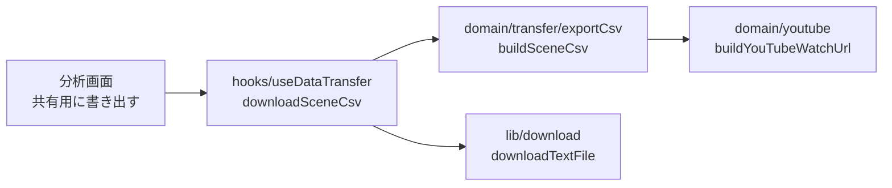

# シーンの動画リンクの書き出し 設計

- 作業ディレクトリ: `.steering/20261003-scene-link-csv/`
- 作成日: 2026-10-03
- ステータス: 承認済み（2026-10-03、利用者の「PR まで作成して」の指示により、PR のレビューで確認する）
- 前提: [requirements.md](./requirements.md)（承認済み）

---

## 1. 実装アプローチ

CSV の生成・動画リンクの生成は UI から独立した純粋関数としてドメイン層に置き、単体テストで網羅する。画面（分析画面）は、今表示しているシーン（`sceneShots`）と設定の前余白を渡してダウンロードするだけにする。



## 2. 動画リンク

```ts
// domain/youtube.ts
export function buildYouTubeWatchUrl(params: { videoId: string; start: number }): string;
// → https://youtu.be/{videoId}?t={開始秒}
```

- 開始 = `max(0, floor(記録時刻 − 前余白))`（整数秒。シーンが欠けないよう切り捨てる）
- 通常の視聴リンクにする理由: 再生範囲を指定できる埋め込み用の URL（`/embed/{id}?start=&end=`）は、参照元（Referer）なしで直接開くと YouTube が「エラー 153」を返して再生できない。Playwright で次のとおり確認した

| リンクの形式 | 直接開いた結果 |
|---|---|
| `https://www.youtube.com/embed/{id}?start=30&end=37`（参照元なし） | エラー 153（再生できない） |
| 同上（参照元 `https://docs.google.com/`） | 再生できる |
| `https://www.youtube.com/watch?v={id}&t=30s` | 30秒から再生できる |
| `https://youtu.be/{id}?t=30` | 30秒から再生できる |

- 短く、スマホでは YouTube アプリで開く `youtu.be` を使う
- 動画IDは保存時に検証済み（`^[A-Za-z0-9_-]{11}$`）。念のため `encodeURIComponent` を通す

## 3. CSV の形式

| 列 | 内容 | 例 |
|---|---|---|
| 試合日 | `YYYY/MM/DD` | 2026/09/20 |
| 対戦 | ホーム vs アウェイ | ○○大学 vs □□大学 |
| 大会 | 大会名（任意） | 秋季リーグ |
| 動画時刻 | `m:ss`（1時間以上は `h:mm:ss`） | 23:41 |
| シュート位置 | 表示名 | レフトバック |
| シュート種別 | 表示名（未入力は空） | カットイン |
| コース | `コース1` など（未入力は空） | コース1 |
| 結果 | 表示名 | 失点 |
| GKの対応 | 表示名（未入力は空） | |
| 利き手 | 表示名（未入力は空） | 左 |
| ポジション | 表示名（未入力は空） | LB |
| 数的状況 | 表示名（未入力は空） | 同数 |
| 前後半 | 前半・後半（未入力は空） | 後半 |
| メモ | 自由記述 | |
| 動画リンク | 2章の URL | https://youtu.be/dQw4w9WgXcQ?t=1417 |

- 1行目は列名。行の順番はシーン一覧と同じ（試合日 → 動画時刻）
- 文字コードは UTF-8、先頭に BOM（``）を付ける（Excel で文字化けしないように）。改行は `\r\n`
- 値に `,` `"` 改行が含まれる場合は `"` で囲み、`"` は `""` にする（RFC 4180）
- CSV インジェクション対策（architecture.md 4章）: `=` `+` `-` `@` で始まる値（タブ・CR も）は先頭に `'` を付ける。動画リンクは `https://` で始まるため影響しない
- 表示名は `domain/enums.ts` の `〜Labels` を使う（用語集と一致）

```ts
// domain/transfer/exportCsv.ts
export function toCsv(rows: readonly (readonly string[])[]): string;   // BOM・エスケープ・インジェクション対策
export function buildSceneCsv(params: {
  shots: readonly Shot[];               // シーン一覧と同じ順番
  matchesById: ReadonlyMap<string, Match>;
  preSeconds: number;                   // 動画リンクの開始位置（記録時刻のこの秒数前）
}): string;
export function buildSceneCsvFileName(goalkeeperName: string, localDate: string): string;
// → handball_analysis_scenes_{GK名}_{YYYYMMDD}.csv
```

## 4. 画面

- 分析画面の右列「シーン（n件）」の見出しの横に、「共有用に書き出す（CSV）」ボタンを置く（見出しの文字は変えない）
- シーンが0件のときは無効にする
- 押すと `downloadSceneCsv` を呼び、成功したら「n件のシーンを書き出しました」のトーストを表示する

## 5. 変更するファイル

| ファイル | 変更 |
|---|---|
| `src/domain/youtube.ts` | `buildYouTubeWatchUrl` を追加 |
| `src/domain/transfer/exportCsv.ts` | 新規（`toCsv`・`buildSceneCsv`・`buildSceneCsvFileName`） |
| `src/hooks/useDataTransfer.ts` | `downloadSceneCsv` を追加 |
| `src/pages/AnalysisPage.tsx` | ボタンを追加 |
| テスト | `youtube.test.ts` に追記、`exportCsv.test.ts` を新規、E2E `record-and-analyze.spec.ts` に書き出しの確認を追加 |
| `docs/functional-design.md` | 5.5 の CSV の行に列と動画リンクを追記、4.4 のワイヤフレームにボタン |
| `docs/product-requirements.md` | 8.10 の CSV の説明に動画リンクを追記 |
| `README.md` | 共有の手順と、YouTube の動画を「公開」か「限定公開」にする旨を追記 |

## 6. 影響範囲

- 新しい機能の追加のみ。保存データ・書き出し JSON の形式（`schemaVersion`）は変わらない
- CSP: 書き出しはローカルでのファイル生成のみで、外部への通信はないため変更なし

## 7. 今後（別の作業）

範囲どおりに止まる再生は、アプリを公開したあとに、アプリ内の「切り抜き再生ページ」（例: `/clip?v={動画ID}&start={開始秒}&end={終了秒}`）で実現する。アプリのページに YouTube を埋め込むため参照元が送られ、エラー 153 にならない。データを使わないため、選手はアプリを使っていなくても開ける。CSV にはそのリンクの列を追加する。
