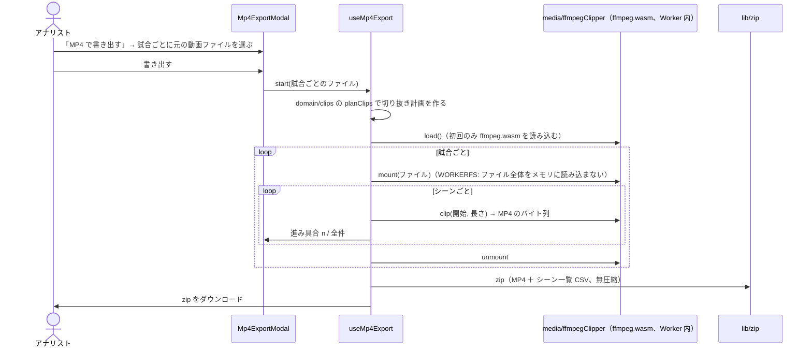

# シーンの MP4 書き出し 設計

- 作業ディレクトリ: `.steering/20261003-scene-mp4-export/`
- 作成日: 2026-10-03
- ステータス: 承認済み（2026-10-03、利用者の「PR まで作成して」の指示により、PR のレビューで確認する）
- 前提: [requirements.md](./requirements.md)（承認済み）

---

## 1. 全体の流れ



## 2. モジュール構成

| ファイル | 層 | 役割 |
|---|---|---|
| `src/domain/clips.ts` | ドメイン | 切り抜き計画（`planClips`）、ファイル名（`clipFileName`）。純粋関数 |
| `src/domain/transfer/exportCsv.ts` | ドメイン | CSV の生成（`toCsv`：BOM・RFC 4180・CSV インジェクション対策）、zip に入れるシーン一覧（`buildClipIndexCsv`） |
| `src/media/ffmpegClipper.ts` | **新しい層 `media/`**（外部ライブラリのラップ。`player/` と同じ扱い） | ffmpeg.wasm の読み込み、ファイルのマウント、切り抜き、中止 |
| `src/lib/zip.ts` | lib | 無圧縮の zip を作る（fflate） |
| `src/hooks/useMp4Export.ts` | hooks | 書き出しの手順と状態（準備中・作成中 n/全件・完了・中止・エラー） |
| `src/components/analysis/Mp4ExportModal.tsx` | components | 試合ごとのファイル選択、進み具合、中止 |
| `src/pages/AnalysisPage.tsx` | pages | 「MP4 で書き出す」ボタン |

- `media/` は `lib/` だけに依存してよい（`domain/`・`db/`・画面に依存しない）。ESLint の層の依存ルールと repository-structure.md に追加する

## 3. 切り抜き計画（domain/clips.ts）

```ts
export type ClipPlan = {
  shotId: string;
  matchId: string;
  start: number;      // 秒（小数第1位）。max(0, 記録時刻 − 前余白)
  duration: number;   // 秒。前余白 + 後余白（開始を0秒に切り詰めた分は短くなる）
  fileName: string;   // 例: 20260920_23m41s_レフトバック_コース1_失点.mp4
};
export function planClips(params: { shots: readonly Shot[]; matchesById: ReadonlyMap<string, Match>; preSeconds: number; postSeconds: number }): ClipPlan[];
```

- ファイル名: `{試合日YYYYMMDD}_{mm}m{ss}s_{シュート位置}_{コース}_{結果}.mp4`（コース未入力は省く）。ファイル名に使えない文字は除く。同じ名前が重なる場合は `_2`・`_3` を付ける
- 並び順はシーン一覧と同じ（試合日 → 動画時刻）

## 4. 切り抜き（media/ffmpegClipper.ts）

```ts
export type Clipper = {
  load(signal?: AbortSignal): Promise<void>;
  mount(file: File): Promise<string>;                      // 入力パスを返す
  clip(input: string, request: { start: number; duration: number }, signal?: AbortSignal): Promise<Uint8Array>;
  unmount(): Promise<void>;
  terminate(): void;
};
export function createClipper(): Clipper;
```

- ffmpeg.wasm（`@ffmpeg/ffmpeg` 0.12、単一スレッド版 `@ffmpeg/core`）を使う。本体の JS・wasm は `?url` で import し、アプリと同じオリジンから配信する（外部の CDN を使わない）。モジュールは `import()` で遅延読み込みし、初回表示の JS に含めない
- 入力は **WORKERFS** でマウントする（ファイル全体をメモリに読み込まないため、数GBのファイルでも扱える）
- コマンド: `-ss {start} -i {input} -t {duration} -map 0:v:0 -map 0:a:0? -c copy -avoid_negative_ts make_zero -movflags +faststart -sn -dn out.mp4`
  - 再エンコードしない（`-c copy`）ので速い。開始はその前のキーフレームからになり、最大で数秒早まる
  - 入力の映像が HEVC の場合は `-tag:v hvc1` を付ける（iPhone で再生できるように）。マウント直後に `-i` の出力（ログ）から映像のコーデックを判定する
- 中止: `AbortSignal` で ffmpeg を止め、Worker を終了する（次回は読み込み直す）

## 5. zip（lib/zip.ts）

- fflate の `Zip` と `ZipPassThrough`（無圧縮）で作り、`Blob` にする（MP4 は圧縮済みのため、圧縮しても小さくならない）
- zip の中身: 各 MP4 と `シーン一覧.csv`（ファイル名・試合日・対戦・動画時刻・シュート位置・種別・コース・結果・GKの対応・利き手・ポジション・数的状況・前後半・メモ）
- zip のファイル名: `handball_analysis_clips_{GK名}_{YYYYMMDD}.zip`

## 6. 画面

- 分析画面の「シーン（n件）」の見出しの横に「MP4 で書き出す」ボタン（0件のときは無効）
- `Mp4ExportModal`
  - 対象のシーンを試合ごとに表示し（試合日・対戦・シーン数）、試合ごとに「動画ファイルを選ぶ」（`accept="video/*"`）。選んだファイル名と大きさを表示
  - 「YouTube に上げた動画の元のファイル、または YouTube Studio からダウンロードしたファイルを選んでください」と案内する
  - ファイルを選んでいない試合は「書き出しません」と表示する
  - 書き出し中は進み具合（n / 全件）とバー、「中止」。完了したらダウンロードして「n件の MP4 を書き出しました」
  - 初回の読み込み中は「動画変換の準備をしています（初回のみ、約10MB）」と表示する

## 7. 設定・セキュリティ

- `vercel.json` の CSP の `script-src` に `'wasm-unsafe-eval'` を追加する（WebAssembly の実行に必要）。他のドメインは追加しない
- `vite.config.ts` の `optimizeDeps.exclude` に `@ffmpeg/ffmpeg` を追加する（開発サーバーで Worker を正しく読み込むため）
- 動画ファイルはブラウザの外に送信しない

## 8. テスト

| 種類 | 内容 |
|---|---|
| 単体（domain） | `planClips`（範囲、0秒での切り詰め、ファイル名、重複時の連番、並び順）、`toCsv`・`buildClipIndexCsv` |
| 単体（lib） | `zip` で作った zip を fflate で展開して中身が同じこと |
| E2E（Chromium） | 小さなテスト用動画（`e2e/fixtures/sample.mp4`、ffmpeg で生成した 40秒・320×180・H.264/AAC）を選び、実際の ffmpeg.wasm で書き出す。zip の中の MP4 の数・CSV・MP4 の形式（`ftyp`）を確認する |
| 手動 | 大きなファイル（数百MB〜数GB）での書き出しとメモリ、書き出した MP4 の再生（ffprobe で長さを確認） |

## 9. 影響範囲

- 新しい機能の追加。保存データ・書き出し JSON の形式は変わらない
- 依存関係を追加: `@ffmpeg/ffmpeg`、`@ffmpeg/core`（約32MB の wasm。使うときだけ読み込む）、`fflate`
- 初回表示の JS の大きさは変わらない（遅延読み込みのため）
