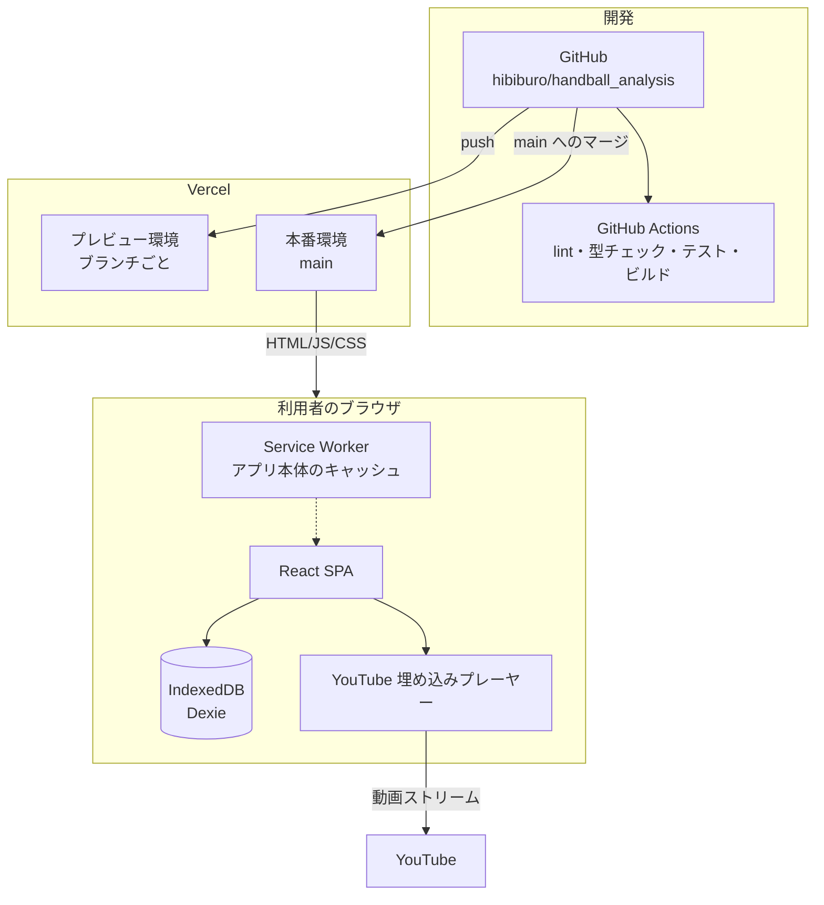
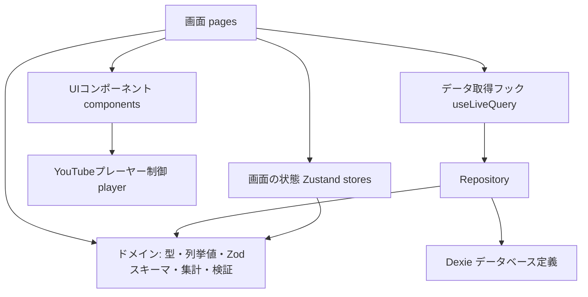
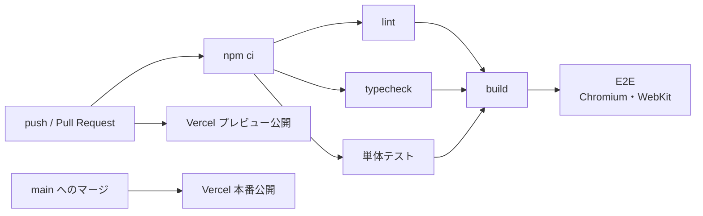

# 技術仕様書

- バージョン: 0.1（初版ドラフト）
- 作成日: 2026-09-28
- ステータス: 承認済み（2026-09-28）
- 前提: [product-requirements.md](./product-requirements.md)、[functional-design.md](./functional-design.md)（いずれも承認済み）

---

## 1. テクノロジースタック

バージョンは 2026-09-28 時点の最新安定版。導入時はメジャーバージョンを固定し、マイナー・パッチの更新は随時取り込む。

### 1.1 アプリケーション

| 区分 | 技術 | バージョン | 選定理由 |
|---|---|---|---|
| 言語 | TypeScript | 6.0.x | 型でデータモデル・列挙値の誤りを防ぐ。7.x は typescript-eslint が未対応（対応範囲 `<6.1.0`）のため、対応するまで 6.0 を使う（2026-09-28 初回実装で判断） |
| UIライブラリ | React | 19.x | コンポーネント設計（functional-design.md 7章）をそのまま実装できる |
| ビルドツール | Vite | 8.x | サーバー不要のSPAに最も単純で、開発サーバー・ビルドが高速 |
| ルーティング | React Router | 8.x | SPA内の画面遷移（SC1〜SC5） |
| スタイリング | Tailwind CSS | 4.x | CLAUDE.md の共通デザインシステム |
| データ保存 | Dexie.js | 4.x | IndexedDB のラッパー。スキーマのバージョン管理、トランザクション、複合インデックスを扱いやすい |
| データの画面反映 | dexie-react-hooks | 4.x | `useLiveQuery` で保存データの変更を画面に自動反映する |
| 画面の状態管理 | Zustand | 5.x | 絞り込み条件、選択中のGK、フォームの直前選択など。軽量でボイラープレートが少ない |
| スキーマ検証 | Zod | 4.x | 取り込みファイルの検証、フォーム入力の検証、型の自動生成を1か所で定義する |
| PWA | vite-plugin-pwa | 1.x | ホーム画面への追加とアプリ本体のオフライン表示（2.3参照） |
| 動画 | YouTube IFrame Player API | − | 公式の埋め込みプレーヤー。型定義は `@types/youtube` |

グラフ描画ライブラリは使わない。ヒートマップ・コート図は項目数が少ないため、SVGとTailwindで自作する。

### 1.2 開発・テストツール

| 区分 | 技術 | バージョン | 用途 |
|---|---|---|---|
| ランタイム | Node.js | 24 LTS 以上 | 開発・ビルド・CI |
| パッケージ管理 | npm | 11.x | 依存関係の管理（`package-lock.json` をコミット） |
| リンター | ESLint | 10.x | 静的解析（typescript-eslint、react-hooks プラグイン） |
| フォーマッター | Prettier | 3.x | コード整形（Tailwind のクラス並び替えプラグインを使う） |
| 単体テスト | Vitest | 5.x | 集計・検証・URL解析・書き出し/取り込みのロジック |
| コンポーネントテスト | Testing Library（React） | 16.x | フォームなどUIの振る舞い |
| IndexedDBのテスト | fake-indexeddb | 6.x | Node上でDexieを使ったRepositoryをテストする |
| E2Eテスト | Playwright | 1.x | 主要な操作の流れ。Chromium と WebKit（Safari相当）で実行する |
| CI | GitHub Actions | − | Pull Request と push で自動検証 |
| ホスティング | Vercel | − | 静的サイトの公開、ブランチごとのプレビューURL |

---

## 2. アーキテクチャ

### 2.1 全体構成



- サーバー側の処理・データベースは持たない。Vercel は静的ファイルの配信のみを行う
- 利用者のデータ（GK・試合・シュート）は、ブラウザの外には送信しない

### 2.2 アプリ内部の層構成

functional-design.md 1章の層を、次の依存方向で実装する（上の層から下の層にのみ依存する）。



| 層 | 依存してよいもの | 禁止事項 |
|---|---|---|
| ドメイン（型・列挙値・Zodスキーマ・集計・検証） | なし（純粋なTypeScript） | React、Dexie、ブラウザAPIへの依存 |
| Repository | ドメイン、Dexie | UIへの依存 |
| YouTubeプレーヤー制御 | YouTube IFrame API | データ保存への依存 |
| 画面・UIコンポーネント | すべての下位層 | IndexedDB を Repository を経由せずに直接操作すること |

ドメイン層を純粋に保つことで、集計・検証を単体テストで網羅でき、将来サーバー保存に変えるときも Repository の差し替えだけで済む。

### 2.3 PWA とオフライン動作

- `vite-plugin-pwa` で Web App Manifest と Service Worker を生成する
- Service Worker はアプリ本体（HTML・JS・CSS・アイコン）のみをキャッシュする。YouTube の動画・APIはキャッシュしない
- オフライン時は、データの閲覧・集計・編集ができる。動画の再生はできないため、プレーヤー領域に「オフラインのため動画を再生できません」と表示する
- 新しいバージョンを公開したら、次回起動時に「更新があります。再読み込み」と案内する（自動で強制再読み込みはしない。入力中のデータを失わないため）

### 2.4 ルーティング

| パス | 画面 |
|---|---|
| `/` | SC1 GK一覧 |
| `/goalkeepers/:goalkeeperId` | SC2 GK詳細 |
| `/matches/:matchId/record` | SC3 記録画面（`?shot={shotId}` でそのシュートを選んだ状態で開く） |
| `/goalkeepers/:goalkeeperId/analysis` | SC4 分析画面 |
| `/settings` | SC5 データ管理・設定 |

モーダル（M1〜M3）はURLを持たない。Vercel では全パスを `index.html` に書き換える設定（`vercel.json` の rewrites）を行う。

---

## 3. 技術的制約と対応

### 3.1 YouTube IFrame Player API

| 制約 | 対応 |
|---|---|
| 投稿者が埋め込みを禁止した動画は再生できない（エラーコード 101 / 150） | 試合登録時に読み込みを試し、エラーなら保存せずに理由を表示する |
| 動画が削除・非公開になると再生できない（エラーコード 100） | 記録データは残し、プレーヤー領域にエラーと「URLを変更」ボタンを表示する |
| iPad の Safari では、利用者の操作なしに音声付きの自動再生ができない | 最初の再生は必ず利用者のタップで始める。連続再生の開始もボタン操作で行う |
| `getCurrentTime()` の精度はブラウザによって約0.1〜0.25秒の誤差がある | 時刻は小数第1位に丸めて保存する。シーン再生は前後に余白（既定3秒・2秒）をとるので誤差は問題にならない |
| API スクリプトは外部から読み込む必要がある | `https://www.youtube.com/iframe_api` を初回のプレーヤー表示時に1回だけ読み込む（アプリ起動時には読み込まない） |
| プライバシー | 埋め込みのホストは `https://www.youtube-nocookie.com` を使う |
| 利用規約 | 動画のダウンロード・切り出し保存・広告の非表示は行わない |

### 3.2 IndexedDB（ブラウザ内保存）

| 制約 | 対応 |
|---|---|
| **Safari は、7日間サイトを開かないとスクリプトで保存したデータを削除することがある**（ホーム画面に追加したWebアプリは対象外） | ①ホーム画面への追加を初回起動時に案内する（PWA）②`navigator.storage.persist()` で永続化を要求する ③バックアップを促す（7日以上書き出していなければ警告） |
| ブラウザのデータ消去・プライベートブラウズで消える | 同上の③。プライベートブラウズを検出したら警告を表示する |
| 保存容量には上限がある | 想定データ量（1GKあたり数百件、全体で数千件、数MB以下）は上限を大きく下回る。`navigator.storage.estimate()` の使用量を設定画面に表示する |
| スキーマ変更時に既存データの移行が必要 | Dexie の `version(n).upgrade()` で移行処理を書く。書き出しJSONの `schemaVersion` と対応させる |

### 3.3 ブラウザ対応

- 対象: 最新版の Safari（iPadOS / macOS）、Chrome、Edge（product-requirements.md 9.1）
- E2E テストは Chromium と WebKit の両方で実行し、Safari 相当の動作を確認する
- `crypto.randomUUID()`（ID生成）は HTTPS または localhost でのみ使えるため、本番・プレビューとも HTTPS で配信する（Vercel の標準）

---

## 4. セキュリティ

| 項目 | 対策 |
|---|---|
| XSS | React の自動エスケープに任せる。`dangerouslySetInnerHTML` は使用禁止（ESLint で検出する） |
| 取り込みファイル | Zod で全項目を検証し、不明なフィールドは取り除く。ファイルサイズの上限を 20MB とする |
| CSV インジェクション | CSV 書き出し時、`=` `+` `-` `@` で始まる文字列の先頭に `'` を付けて、Excel で数式として実行されないようにする |
| YouTube URL | 動画IDだけを取り出して `^[A-Za-z0-9_-]{11}$` で検証し、埋め込みには検証済みのIDのみを使う（URL文字列をそのまま埋め込まない） |
| Content Security Policy | `vercel.json` のヘッダーで設定する（下記） |
| 依存ライブラリ | Dependabot で更新を検知する。CI で `npm audit --audit-level=high` を実行する |

**Content Security Policy（案）**

```
default-src 'self';
script-src 'self' https://www.youtube.com https://s.ytimg.com;
frame-src https://www.youtube-nocookie.com https://www.youtube.com;
img-src 'self' data: https://i.ytimg.com;
style-src 'self' 'unsafe-inline';
connect-src 'self';
worker-src 'self';
```

※ YouTube の埋め込みに必要なドメインは、実装時に動作確認して調整する。

---

## 5. パフォーマンス要件

product-requirements.md 9.2 の要件を、次の設計で満たす。

| 要件 | 目標 | 設計上の対応 |
|---|---|---|
| シュート記録の保存 | 200ms 以内に反映 | IndexedDB への1件書き込みのみ。一覧は `useLiveQuery` で自動更新する |
| 絞り込み・ヒートマップ更新 | 500本・10試合で 1秒以内（目標は100ms以内） | 対象GKのシュートを一度メモリに読み込み、絞り込み・集計はメモリ上の純粋関数で計算する。結果は `useMemo` でキャッシュする |
| 初回表示 | 3秒以内 | 初回に読み込む JS は gzip 後 200KB 以内。分析画面とデータ管理画面は遅延読み込み（`React.lazy`）にする。YouTube API は必要になってから読み込む |
| 2回目以降の起動 | 1秒以内 | Service Worker のキャッシュから表示する |

性能の確認方法:
- 集計関数は、1万件のダミーデータで 100ms 以内に終わることを単体テストで確認する
- ビルド時にバンドルサイズを表示し、上限を超えたら CI で警告する

---

## 6. 開発ツールと手法

### 6.1 npm スクリプト

| コマンド | 内容 |
|---|---|
| `npm run dev` | 開発サーバー起動 |
| `npm run build` | 型チェック＋本番ビルド |
| `npm run preview` | ビルド結果をローカルで確認 |
| `npm run lint` | ESLint |
| `npm run format` | Prettier で整形 |
| `npm run typecheck` | TypeScript の型チェックのみ |
| `npm run test` | Vitest（単体・コンポーネント） |
| `npm run test:e2e` | Playwright（E2E） |

### 6.2 テスト方針

| 種類 | 対象 | ツール |
|---|---|---|
| 単体テスト | 集計（セーブ率・ヒートマップ・クロス集計）、入力検証（V1〜V7）、YouTube URL 解析、書き出し/取り込み、CSV 生成 | Vitest |
| Repository のテスト | CRUD、連動削除、取り込みのトランザクション | Vitest + fake-indexeddb |
| コンポーネントテスト | ShotForm（必須項目・条件付き表示）、FilterPanel、GoalHeatmap | Vitest + Testing Library |
| E2E テスト | GK登録 → 試合登録 → シュート記録 → 分析 → 連続再生、書き出し → 取り込み | Playwright（YouTube プレーヤーはモックに差し替える） |

- YouTube プレーヤーは `player` 層のインターフェースを通して使い、テストではモック実装に差し替える
- カバレッジの目標: ドメイン層 90% 以上。UI は主要な振る舞いのみ

### 6.3 CI / CD



- GitHub Actions: lint・型チェック・単体テスト・ビルド・E2E がすべて成功しないとマージできない（main のブランチ保護）
- Vercel: GitHub 連携で、ブランチごとにプレビューURL、main で本番を自動公開する

### 6.4 開発手法

- CLAUDE.md の開発プロセスに従う（docs/ → .steering/ → 実装 → 品質チェック）
- 1つの作業ごとにブランチを作り、Pull Request でマージする
- コード変更後は必ず `npm run lint` と `npm run typecheck` を実行する

---

## 7. 将来の拡張に向けた方針（対象外・参考）

| 拡張 | 想定される変更 |
|---|---|
| ログイン・チーム共有 | Repository をサーバーAPI実装（例: Supabase など）に差し替える。ドメイン層・画面はそのまま使う |
| 複数チーム向けサービス | 上記に加え、チームごとのデータ分離と権限管理 |
| PDF レポート出力 | ヒートマップの SVG をそのまま使って印刷用ページを作る |
