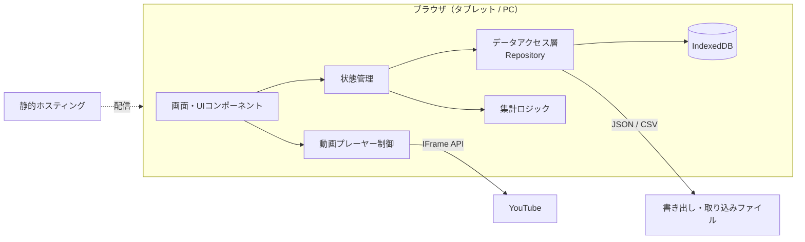
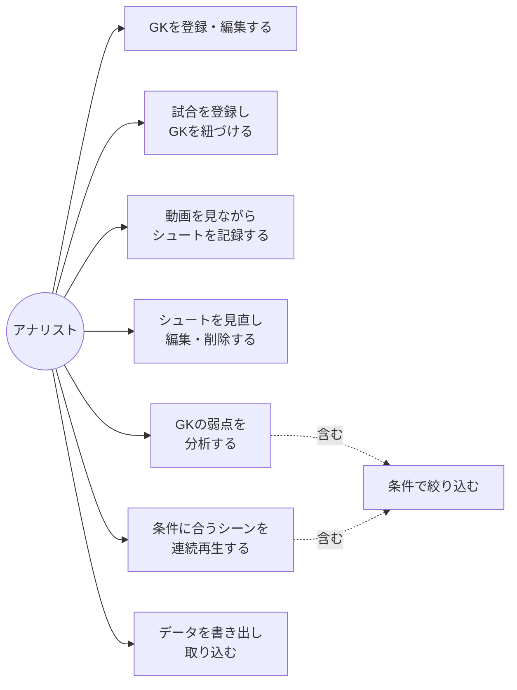
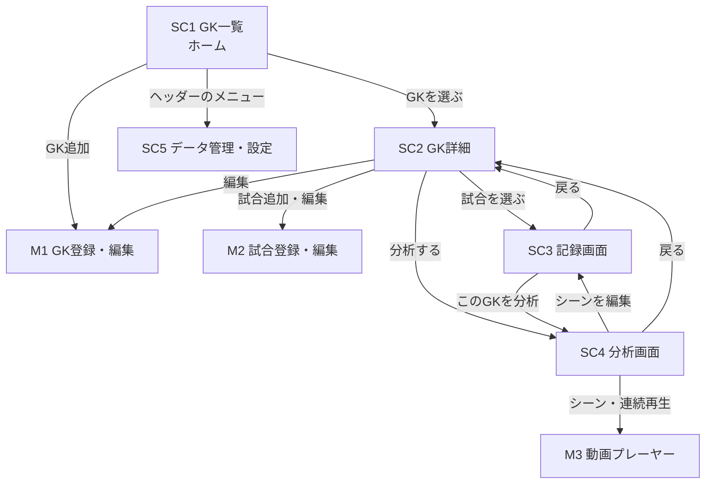
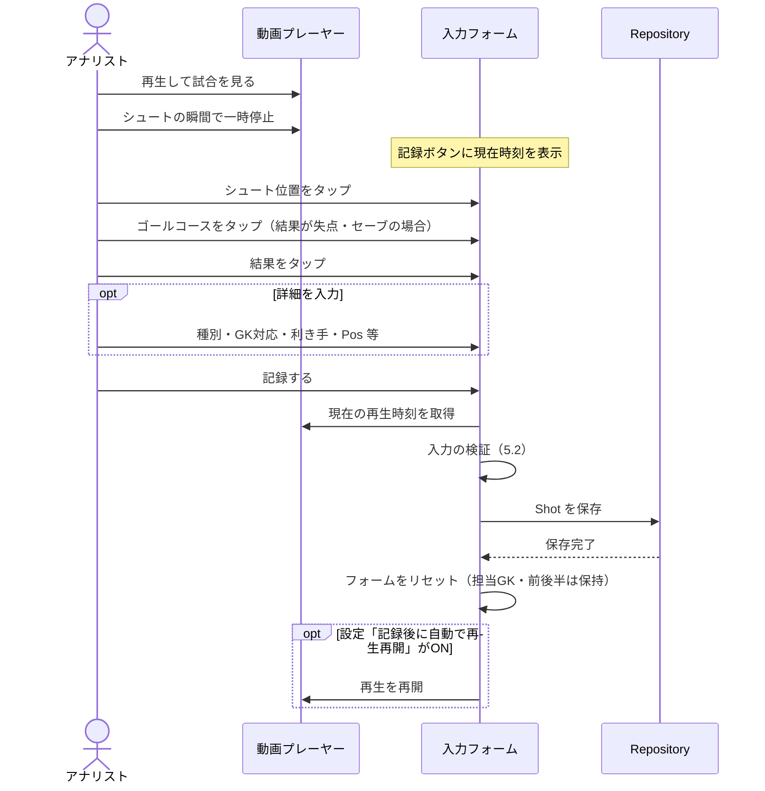
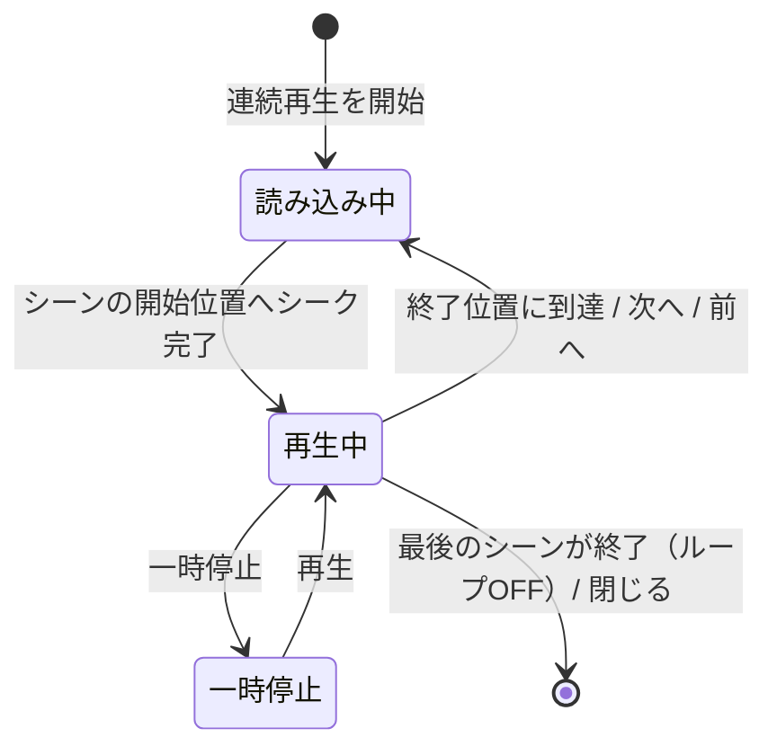
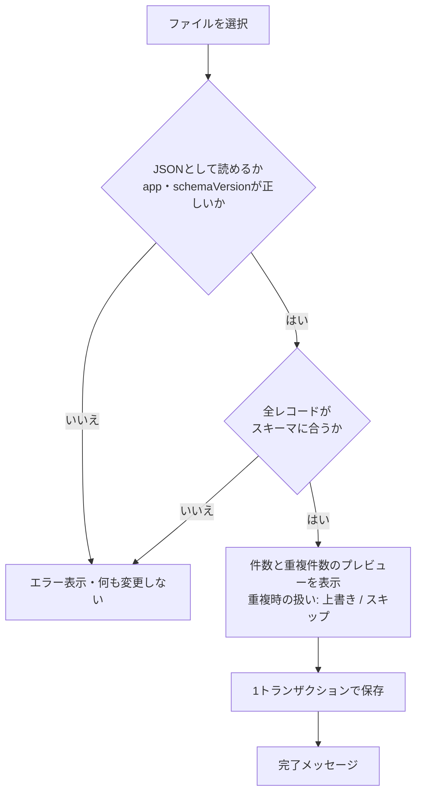
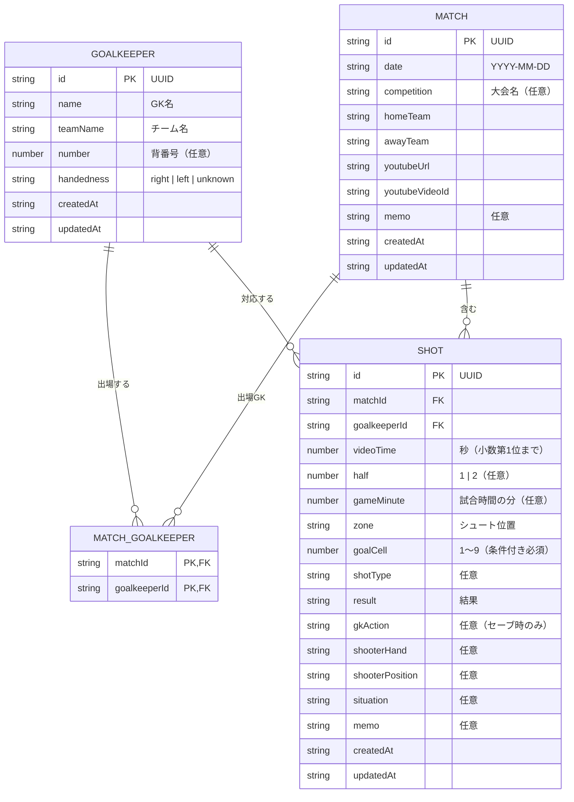
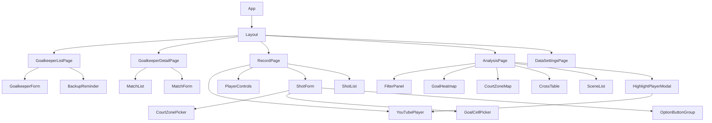

# 機能設計書

- バージョン: 0.1（初版ドラフト）
- 作成日: 2026-09-28
- ステータス: 承認済み（2026-09-28）
- 前提: [product-requirements.md](./product-requirements.md)（承認済み）

---

## 1. システム構成

サーバーを持たない、ブラウザ完結型のSPA（シングルページアプリケーション）。
データはブラウザの IndexedDB に保存し、動画は YouTube IFrame Player API で埋め込み再生する。



| 層 | 役割 |
|---|---|
| 画面・UIコンポーネント | 画面表示とユーザー操作の受け付け |
| 状態管理 | 画面をまたぐ状態（絞り込み条件、選択中のGK・試合など）の保持 |
| データアクセス層（Repository） | IndexedDB への CRUD、書き出し・取り込み、スキーマ検証 |
| 集計ロジック | 絞り込み、ヒートマップ・クロス集計の計算（UIに依存しない純粋関数） |
| 動画プレーヤー制御 | YouTube IFrame API のラップ（再生・停止・シーク・速度・時刻取得・動画切り替え） |

---

## 2. ユースケース



---

## 3. 画面一覧と画面遷移

### 3.1 画面一覧

| ID | 画面名 | 種別 | 概要 | 対応機能 |
|---|---|---|---|---|
| SC1 | GK一覧（ホーム） | 画面 | 相手GKをチーム別に一覧表示。検索、GK追加、最終バックアップ日時の表示 | F2, F10 |
| SC2 | GK詳細 | 画面 | GKの情報、紐づく試合の一覧、試合追加、分析画面への入口 | F1, F2, F9 |
| SC3 | 記録画面 | 画面 | 1試合分の動画再生、シュート記録、シュート一覧 | F3, F4, F5, F11 |
| SC4 | 分析画面 | 画面 | 1GK分の絞り込み、ヒートマップ、クロス集計、シーン一覧、連続再生 | F6, F7, F8, F9 |
| SC5 | データ管理・設定 | 画面 | 書き出し・取り込み、各種設定 | F10 |
| M1 | GK登録・編集 | モーダル | GKの登録項目を入力 | F2 |
| M2 | 試合登録・編集 | モーダル | 試合情報、YouTube URL、紐づけるGKを入力 | F1 |
| M3 | 動画プレーヤー（重ね表示） | モーダル | 分析画面上でシーン再生・連続再生を行う | F8 |

### 3.2 画面遷移図



- 記録画面は **試合単位**、分析画面は **GK単位**（既定で紐づく全試合を合算）
- 1試合に複数GKが紐づく場合でも、記録画面は1つで、シュートごとに担当GKを選ぶ
- 分析画面の「シーンを編集」は、そのシュートを選んだ状態で記録画面を開く

---

## 4. ワイヤフレーム

### 4.1 SC1 GK一覧（ホーム）

```
┌──────────────────────────────────────────────┐
│ handball_analysis                 [データ管理] │
├──────────────────────────────────────────────┤
│ 🔍 チーム名・GK名で検索          [+ GKを追加] │
│ ⚠ 最終バックアップ: 12日前  [今すぐ書き出す] │
├──────────────────────────────────────────────┤
│ ▼ ○○大学                                     │
│   #1 山田 太郎  右  試合 4 / シュート 183    │
│   #12 佐藤 次郎 左  試合 1 / シュート 22     │
│ ▼ △△高校                                     │
│   #16 鈴木 一郎 右  試合 2 / シュート 95     │
└──────────────────────────────────────────────┘
```

### 4.2 SC2 GK詳細

```
┌──────────────────────────────────────────────┐
│ ← GK一覧   #1 山田 太郎（○○大学・右）  [編集] │
├──────────────────────────────────────────────┤
│ 合計: 試合 4 / シュート 183 / セーブ率 31%    │
│                            [このGKを分析する] │
├──────────────────────────────────────────────┤
│ 試合一覧                          [+ 試合追加] │
│ 2026/09/20 秋季リーグ ○○大 vs □□大  52本 ▶  │
│ 2026/09/13 秋季リーグ ○○大 vs ◇◇大  48本 ▶  │
│ …                                            │
└──────────────────────────────────────────────┘
```

### 4.3 SC3 記録画面（タブレット横向き）

```
┌─────────────────────────────┬────────────────────┐
│ ← 戻る  ○○大 vs □□大 9/20   │ 担当GK [#1 山田 ▼] │
├─────────────────────────────┤ 前後半 [前半|後半] │
│                             ├────────────────────┤
│                             │ シュート位置 *     │
│        YouTube 動画         │  ┌──────────────┐  │
│                             │  │ コート図      │  │
│                             │  │ ゾーンをタップ│  │
├─────────────────────────────┤  └──────────────┘  │
│ ⏪5 ◀2 ▶/⏸ 2▶ 5⏩  [1.0x▼] │ ゴールコース       │
│ 現在 23:41                  │  ┌──┬──┬──┐       │
├─────────────────────────────┤  │1 │2 │3 │       │
│ シュート一覧（52本）         │  ├──┼──┼──┤       │
│ 23:12 左45 ジャンプ 7 失点 ✎│  │4 │5 │6 │       │
│ 21:05 RW  ステップ 3 セーブ ✎│  ├──┼──┼──┤       │
│ 18:40 7m        1 失点     ✎│  │7 │8 │9 │       │
│ …                           │  └──┴──┴──┘       │
│                             │ 結果 *             │
│                             │ [失点][セーブ]     │
│                             │ [ポスト・バー][枠外][DFブロック] │
│                             │ ▸ 詳細（種別・GK対応│
│                             │   ・利き手・Pos等） │
│                             │ [記録する 23:41]   │
└─────────────────────────────┴────────────────────┘
```

- 入力欄は縦に「必須項目 → 詳細（折りたたみ）」の順に並べる。詳細欄の開閉状態は保持する
- 「記録する」ボタンに、記録される動画時刻を常に表示する

### 4.4 SC4 分析画面

```
┌──────────┬────────────────────────┬──────────────┐
│ ← 戻る   #1 山田 太郎（○○大学）  対象: 4試合 183本 │
├──────────┼────────────────────────┼──────────────┤
│ 絞り込み  │ 表示 [セーブ率|失点率|本数] │ シーン（27件）│
│ 試合 ☑☑☑☑│  ┌──────┬──────┬──────┐ │ ▶ 9/20 23:12 │
│ 位置 [▼] │  │ 12本 │  8本 │ 15本 │ │   左45 7 失点│
│ コース[▼]│  │ 17%  │ 50%  │ 20%  │ │ ▶ 9/20 18:40 │
│ 種別 [▼] │  ├──────┼──────┼──────┤ │ ▶ 9/13 31:02 │
│ 結果 [▼] │  │  …   │  …   │  …   │ │ …            │
│ 利き手[▼]│  └──────┴──────┴──────┘ │              │
│ Pos  [▼] │ コート図ゾーン別セーブ率    │              │
│ 数的 [▼] │ クロス集計 [位置×コース ▼]  │ [▶ 連続再生] │
│ 前後半[▼]│  表                        │              │
│ [クリア] │                            │              │
└──────────┴────────────────────────┴──────────────┘
```

- ヒートマップのコースをタップすると、そのコースが「ゴールコース」の絞り込みに追加され、シーン一覧も絞り込まれる
- シーンをタップすると M3（動画プレーヤー）が重ねて表示され、そのシーンを再生する

---

## 5. 主要機能の処理設計

### 5.1 シュート記録の流れ（F4）

ユーザーが自分で一時停止してから入力する方式とする。



- **動画時刻の確定タイミング**: 「記録する」を押したときのプレーヤーの再生位置
- **最小操作数**: 一時停止 → 位置 → コース → 結果 → 記録（自動再開ON）＝ **5タップ**（PRD S2「平均6タップ以内」を満たす）
- **時刻の微調整**: 一覧から編集するとき、±0.5秒ボタンまたは「現在の再生位置で上書き」ボタンで修正できる
- **取り消し**: 保存直後に「元に戻す」トーストを5秒間表示する

### 5.2 入力検証ルール

| ルール | 内容 |
|---|---|
| V1 | 担当GK・シュート位置・結果は必須 |
| V2 | 結果が「失点」「セーブ」の場合、ゴールコースは必須 |
| V3 | 結果が「ポスト・バー」の場合、ゴールコースは任意（当たった付近を記録できる） |
| V4 | 結果が「枠外」「DFブロック」の場合、ゴールコースとGKの対応は入力不可（非表示） |
| V5 | GKの対応は結果が「セーブ」の場合のみ入力可 |
| V6 | 動画時刻は 0 以上、動画の長さ以下 |
| V7 | メモは500文字以内、チーム名・GK名は50文字以内 |

必須項目が揃わないうちは「記録する」ボタンを無効にし、未入力の項目を強調する。

### 5.3 集計ロジック（F6, F7, F9）

**指標の定義**

| 指標 | 定義 |
|---|---|
| 枠内シュート数 | 結果が「失点」または「セーブ」のシュート数 |
| セーブ率 | セーブ数 ÷ 枠内シュート数 |
| 失点率 | 失点数 ÷ 枠内シュート数（＝ 1 − セーブ率） |
| シュート本数 | 全結果を含むシュート数（ヒートマップの「本数」表示では、コースが記録されたもののみ） |

- ポスト・バー、枠外、DFブロックはGKが止めたわけではないため、セーブ率の計算からは除外する（本数としては集計・表示する）
- 枠内シュート数が「参考値の閾値」（既定3本）未満のセルは、斜線と「参考」ラベルで表示する

**ヒートマップの配色**

- 「失点率」表示: 失点率が高いほど濃い色（＝弱点が目立つ）
- 「セーブ率」表示: セーブ率が高いほど濃い色
- 「本数」表示: 本数が多いほど濃い色
- 色は単色の濃淡（連続スケール）とし、数値ラベルを必ず併記する

**絞り込み**

- 条件は項目ごとに複数値を選べる（同じ項目内はOR、項目どうしはAND）
- 未指定の項目は全件を対象とする
- 絞り込み条件は分析画面の状態としてGKごとに保持し、画面を開き直しても復元する

**クロス集計**

- 行×列の組み合わせを選択式にする
    - シュート位置 × ゴールコース（既定）
    - シュート種別 × 結果
    - シュート位置 × 結果
    - シューターの利き手 × ゴールコース
    - 試合 × 結果（試合ごとの内訳）
- 各セルに「失点/枠内（失点率）」を表示する

集計ロジックはUIから独立した純粋関数（`入力: Shot[] と条件 → 出力: 集計結果`）として実装し、単体テストの対象とする。

### 5.4 ハイライト連続再生（F8）



- プレイリスト: 現在の絞り込み結果を「試合日 → 動画時刻」の昇順に並べる
- 各シーンは `開始 = 記録時刻 − 前余白（既定3秒）`、`終了 = 記録時刻 + 後余白（既定2秒）` で再生する
- ループONの場合、最後のシーンが終了したら先頭のシーンに戻る
- 次のシーンが別の試合（別の動画）の場合は、プレーヤーの動画を切り替えてから開始位置にシークする
- 同じ動画内でシーン同士が重なる場合も結合はせず、シーンごとに再生する（位置・結果の表示と対応させるため）
- 再生中は、シーン情報（試合・時刻・位置・コース・結果・種別）と「n / 全件」を重ねて表示する

### 5.5 書き出し・取り込み（F10）

**書き出し**

| 種類 | 形式 | 内容 |
|---|---|---|
| 全データ | JSON | すべてのGK・試合・紐づけ・シュート・設定 |
| GK単位 | JSON | そのGKと、紐づく試合・紐づけ・シュート |
| 試合単位 | JSON | その試合と、紐づくGK・紐づけ・シュート |
| 集計用 | CSV | 分析画面の現在の絞り込み結果のシュート一覧（1行1シュート、UTF-8 BOM付き。Excelで文字化けしないように） |

ファイル名の例: `handball_analysis_all_20260928.json`、`handball_analysis_gk_山田太郎_20260928.json`

全データを書き出したときに `lastBackupAt` を更新する。

**書き出しJSONの構造**

```json
{
  "app": "handball_analysis",
  "schemaVersion": 1,
  "exportedAt": "2026-09-28T14:00:00.000Z",
  "scope": "all",
  "goalkeepers": [],
  "matches": [],
  "matchGoalkeepers": [],
  "shots": []
}
```

**取り込みの流れ**



- 取り込みは1トランザクションで行い、途中で失敗した場合はすべて元に戻す
- 古い `schemaVersion` のファイルは移行処理を通してから取り込む。新しい `schemaVersion` のファイルは拒否する
- 参照整合性を検証する（Shot の matchId / goalkeeperId が、ファイル内または既存データに存在すること）

### 5.6 YouTube URL の解析（F1）

次の形式から動画IDを取り出す。取り出せない場合はエラーとする。

- `https://www.youtube.com/watch?v={id}`（`t=` などのパラメータは無視する）
- `https://youtu.be/{id}`
- `https://www.youtube.com/shorts/{id}`
- `https://www.youtube.com/embed/{id}`
- `https://m.youtube.com/watch?v={id}`

動画IDは `^[A-Za-z0-9_-]{11}$` で検証する。
試合登録時にプレーヤーで読み込みを試し、埋め込み不可のエラーを受け取った場合は保存せずにメッセージを表示する。

### 5.7 キーボードショートカット（F11、記録画面・PC）

| キー | 操作 |
|---|---|
| Space | 再生・一時停止 |
| ← / → | 2秒戻る / 進む |
| Shift + ← / → | 5秒戻る / 進む |
| , / . | 0.1秒戻る / 進む（一時停止中） |
| 1〜9 | ゴールコースを選択 |
| G / S / P / M / B | 結果: 失点 / セーブ / ポスト・バー / 枠外 / DFブロック |
| Enter | 記録する |
| Ctrl(⌘) + Z | 直前の記録を取り消す |

テキスト入力欄にフォーカスがある間はショートカットを無効にする。

---

## 6. データモデル

### 6.1 ER図



設定（Settings）はエンティティとの関連を持たない1件のレコードとして別に保存する。

### 6.2 列挙値

コード上の値（英語）と表示名（日本語）の対応。最終的な用語は glossary.md で確定する。

| 項目 | コード値 → 表示名 |
|---|---|
| handedness / shooterHand | `right` 右、`left` 左、`unknown` 不明 |
| zone | `lw` 左ウイング、`lb` 左45度、`cb` 中央（9m）、`rb` 右45度、`rw` 右ウイング、`pivot_l` 6m左、`pivot_c` 6m中央、`pivot_r` 6m右、`seven_m` 7mスロー、`fast_break` 速攻、`long` ロングシュート |
| goalCell | `1`〜`9`（上段左から右へ1・2・3、中段4・5・6、下段7・8・9。シューターから見た向き） |
| shotType | `jump` ジャンプ、`step` ステップ、`running` ランニング、`diving` 倒れ込み、`lob` ループ、`bounce` バウンド、`spin` スピン、`other` その他 |
| result | `goal` 失点、`save` セーブ、`post` ポスト・バー、`miss` 枠外、`blocked` DFブロック |
| gkAction | `hand` 手、`foot` 足、`body` 体、`none` 反応なし |
| shooterPosition | `LW`、`LB`、`CB`、`RB`、`RW`、`PV` |
| situation | `even` 同数、`power_play` 数的優位、`short_handed` 数的不利 |

※ `situation` はシュートする側（相手GKから見た攻撃側）から見た数的状況とする。

### 6.3 設定（Settings）

| キー | 型 | 既定値 | 説明 |
|---|---|---|---|
| highlightPreSeconds | number | 3 | シーン再生・ジャンプ時の前余白（秒） |
| highlightPostSeconds | number | 2 | シーン再生の後余白（秒） |
| autoResumeAfterRecord | boolean | true | 記録後に自動で再生を再開する |
| lowSampleThreshold | number | 3 | ヒートマップで参考値扱いにする枠内シュート数の閾値 |
| lastBackupAt | string \| null | null | 最後に全データを書き出した日時 |

### 6.4 IndexedDB のストア設計

| ストア | キー | インデックス |
|---|---|---|
| goalkeepers | id | teamName |
| matches | id | date |
| matchGoalkeepers | [matchId, goalkeeperId] | goalkeeperId |
| shots | id | matchId, goalkeeperId, [matchId, videoTime] |
| settings | key（固定値 `"app"`） | − |

### 6.5 削除時の扱い

| 削除対象 | 連動して削除するもの | 確認ダイアログ |
|---|---|---|
| 試合 | その試合の MatchGoalkeeper、Shot | 件数を表示して確認 |
| GK | その GK の MatchGoalkeeper、Shot（試合自体は残す） | 件数を表示して確認 |
| 試合からのGKの紐づけ解除 | その試合でそのGKが担当した Shot があれば解除不可 | − |
| シュート | なし | 確認なし（取り消しトーストで対応） |

---

## 7. コンポーネント設計



| コンポーネント | 責務 |
|---|---|
| YouTubePlayer | IFrame API の読み込みとラップ。`play / pause / seekTo / getCurrentTime / setPlaybackRate / loadVideo(id, start, end)` を提供し、状態変化とエラーを通知する |
| PlayerControls | 再生・停止、±スキップ、速度変更、現在時刻表示 |
| ShotForm | シュート入力と検証、保存。担当GK・前後半の直前選択を保持 |
| CourtZonePicker | コート図（SVG）でシュート位置ゾーンを選ぶ。分析画面の CourtZoneMap と図形を共有する |
| GoalCellPicker | 3×3のゴールコースを選ぶ。GoalHeatmap とグリッドの描画を共有する |
| OptionButtonGroup | 種別・結果などの単一選択ボタン群（44px以上のタップ領域） |
| ShotList | 試合内シュートの時系列一覧。行タップでシーク、編集・削除 |
| FilterPanel | 絞り込み条件の編集。条件は状態管理に保持 |
| GoalHeatmap | コース別の指標の表示、表示切り替え、セルタップで絞り込み |
| CourtZoneMap | ゾーン別セーブ率の表示 |
| CrossTable | 2軸の組み合わせを選べるクロス集計表 |
| SceneList | 絞り込み結果のシーン一覧 |
| HighlightPlayerModal | 連続再生（5.4の状態遷移）、シーン情報の重ね表示 |
| BackupReminder | 最終バックアップからの経過日数を表示し、7日以上なら警告する |

---

## 8. API設計

初期リリースではバックエンドを持たないため、外部APIは YouTube IFrame Player API のみ利用する。
将来ログイン・チーム共有を追加する場合に備え、データアクセスは Repository インターフェース経由に限定し、IndexedDB 実装をサーバーAPI実装に差し替えられるようにしておく。

```
interface GoalkeeperRepository { list(); get(id); save(gk); delete(id); }
interface MatchRepository      { listByGoalkeeper(gkId); get(id); save(match, gkIds); delete(id); }
interface ShotRepository       { listByMatch(matchId); listByGoalkeeper(gkId, matchIds?); save(shot); delete(id); }
interface DataTransferService  { exportAll(); exportGoalkeeper(id); exportMatch(id); importFile(file, onConflict); }
```
