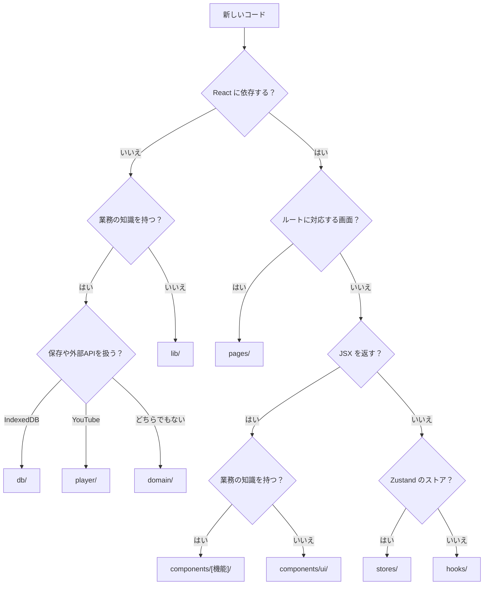

# リポジトリ構造定義書

- バージョン: 0.1（初版ドラフト）
- 作成日: 2026-09-28
- ステータス: 承認済み（2026-09-28）
- 前提: [architecture.md](./architecture.md)（承認済み）

---

## 1. 全体構成

```
handball_analysis/
├── .github/
│   ├── workflows/
│   │   └── ci.yml                 # lint・型チェック・テスト・ビルド・E2E
│   └── dependabot.yml             # 依存ライブラリの更新検知
├── .steering/                     # 作業単位のドキュメント（CLAUDE.md 参照）
│   └── [YYYYMMDD]-[開発タイトル]/
│       ├── requirements.md
│       ├── design.md
│       └── tasklist.md
├── docs/                          # 永続的ドキュメント
│   ├── product-requirements.md
│   ├── functional-design.md
│   ├── architecture.md
│   ├── repository-structure.md
│   ├── development-guidelines.md
│   ├── glossary.md
│   └── images/                    # 必要な場合のみ（PNG / SVG）
├── e2e/                           # Playwright の E2E テスト
│   ├── fixtures/                  # テスト用データ（書き出しJSONなど）
│   ├── mocks/                     # YouTube プレーヤーのモック
│   └── *.spec.ts
├── public/                        # そのまま配信する静的ファイル
│   ├── icons/                     # PWA アイコン
│   └── favicon.svg
├── src/                           # アプリケーションのソースコード（2章）
├── .gitignore
├── CLAUDE.md
├── README.md
├── eslint.config.js
├── index.html
├── package.json
├── package-lock.json
├── playwright.config.ts
├── prettier.config.js
├── tsconfig.json
├── tsconfig.node.json
├── vercel.json                    # SPA の rewrites、セキュリティヘッダー（CSP）
├── vite.config.ts                 # Vite・PWA プラグイン設定
└── vitest.config.ts
```

---

## 2. `src/` の構成

architecture.md 2.2 の層構成に対応させて、**層ごとにディレクトリを分ける**。

```
src/
├── main.tsx                       # エントリーポイント（React の起動、PWA の登録）
├── App.tsx                        # ルーター定義とレイアウト
├── index.css                      # Tailwind の読み込み、テーマ定義
│
├── domain/                        # ドメイン層（純粋な TypeScript）
│   ├── enums.ts                   # 列挙値（zone, result, shotType など）と表示名
│   ├── schemas.ts                 # Zod スキーマ（Goalkeeper, Match, Shot, Settings, 書き出しファイル）
│   ├── types.ts                   # スキーマから生成した型
│   ├── validation.ts              # シュートの入力検証（V1〜V7）
│   ├── youtube.ts                 # YouTube URL の解析・動画IDの検証
│   ├── clips.ts                   # シーンの切り抜き計画・MP4 のファイル名（2026-10-03 追加）
│   ├── stats/
│   │   ├── filter.ts              # 絞り込み
│   │   ├── metrics.ts             # セーブ率・失点率などの指標
│   │   ├── heatmap.ts             # ゴール9分割・ゾーン別の集計
│   │   └── crossTable.ts          # クロス集計
│   ├── playlist.ts                # ハイライトのプレイリスト生成
│   └── transfer/
│       ├── exportJson.ts          # 書き出しJSONの生成
│       ├── importJson.ts          # 取り込みファイルの検証・重複判定
│       ├── migrations.ts          # schemaVersion ごとの移行処理
│       └── exportCsv.ts           # CSV 生成（BOM、CSVインジェクション対策）
│
├── db/                            # データアクセス層
│   ├── database.ts                # Dexie のデータベース定義（ストア・インデックス・バージョン）
│   └── repositories/
│       ├── goalkeeperRepository.ts
│       ├── matchRepository.ts
│       ├── shotRepository.ts
│       ├── settingsRepository.ts
│       └── dataTransferService.ts # 書き出し・取り込み（トランザクション）
│
├── player/                        # YouTube プレーヤー制御
│   ├── types.ts                   # VideoPlayer インターフェース（テストでモックに差し替える）
│   ├── loadYouTubeApi.ts          # IFrame API スクリプトの遅延読み込み
│   └── youTubePlayer.ts           # IFrame API をラップした VideoPlayer の実装
│
├── media/                         # 動画の切り抜き（ffmpeg.wasm のラップ。2026-10-03 追加）
│   └── ffmpegClipper.ts           # 元の動画ファイルから区間を MP4 に切り抜く（WORKERFS・中止）
│
├── stores/                        # 画面の状態（Zustand）
│   ├── analysisFilterStore.ts     # GK ごとの絞り込み条件
│   └── shotFormStore.ts           # 記録フォームの直前選択（担当GK・前後半・詳細欄の開閉）
│
├── hooks/                         # 画面から使うフック
│   ├── useGoalkeepers.ts          # useLiveQuery によるデータ取得
│   ├── useMatches.ts
│   ├── useShots.ts
│   ├── useSettings.ts
│   ├── useVideoPlayer.ts          # プレーヤーの状態と操作
│   └── useKeyboardShortcuts.ts
│
├── components/                    # UIコンポーネント
│   ├── ui/                        # 汎用部品（業務知識を持たない）
│   │   ├── Button.tsx
│   │   ├── Modal.tsx
│   │   ├── Toast.tsx
│   │   ├── ConfirmDialog.tsx
│   │   └── OptionButtonGroup.tsx
│   ├── layout/
│   │   ├── Layout.tsx
│   │   └── BackupReminder.tsx
│   ├── goalkeeper/
│   │   └── GoalkeeperForm.tsx
│   ├── match/
│   │   ├── MatchForm.tsx
│   │   └── MatchList.tsx
│   ├── video/
│   │   ├── YouTubePlayer.tsx
│   │   ├── PlayerControls.tsx
│   │   └── HighlightPlayerModal.tsx
│   ├── court/                     # コート図・ゴール図（記録と分析で共有）
│   │   ├── CourtZoneShape.tsx     # ゾーンの SVG 図形定義
│   │   ├── CourtZonePicker.tsx
│   │   ├── CourtZoneMap.tsx
│   │   ├── GoalGrid.tsx           # 3×3 グリッドの描画
│   │   ├── GoalCellPicker.tsx
│   │   └── GoalHeatmap.tsx
│   ├── shot/
│   │   ├── ShotForm.tsx
│   │   └── ShotList.tsx
│   └── analysis/
│       ├── FilterPanel.tsx
│       ├── CrossTable.tsx
│       └── SceneList.tsx
│
├── pages/                         # 画面（ルートに対応）
│   ├── GoalkeeperListPage.tsx     # /
│   ├── GoalkeeperDetailPage.tsx   # /goalkeepers/:goalkeeperId
│   ├── RecordPage.tsx             # /matches/:matchId/record
│   ├── AnalysisPage.tsx           # /goalkeepers/:goalkeeperId/analysis（遅延読み込み）
│   ├── SettingsPage.tsx           # /settings（遅延読み込み）
│   └── NotFoundPage.tsx
│
├── lib/                           # 特定の層に属さない小さな汎用関数
│   ├── id.ts                      # crypto.randomUUID のラッパー
│   ├── time.ts                    # 秒 ⇔ mm:ss の変換、丸め
│   ├── download.ts                # ファイルのダウンロード
│   ├── storage.ts                 # 保存領域の永続化・使用量
│   └── zip.ts                     # 無圧縮の zip の作成（fflate）
│
└── test/                          # テスト共通の設定・補助
    ├── setup.ts                   # Vitest のセットアップ（fake-indexeddb など）
    ├── factories.ts               # テストデータの生成
    └── mockVideoPlayer.ts         # VideoPlayer のモック
```

---

## 3. ディレクトリの役割と依存ルール

| ディレクトリ | 役割 | import してよいもの |
|---|---|---|
| `domain/` | 型・列挙値・スキーマ・検証・集計など業務ロジック | `lib/` のみ |
| `db/` | IndexedDB への保存・読み込み、書き出し・取り込み | `domain/`, `lib/` |
| `player/` | YouTube IFrame API の制御 | `lib/` のみ |
| `media/` | ffmpeg.wasm による動画の切り抜き | `lib/` のみ |
| `stores/` | 画面をまたぐ状態 | `domain/`, `lib/` |
| `hooks/` | データ取得・プレーヤー操作・動画の切り抜きなどを画面に提供 | `db/`, `player/`, `media/`, `stores/`, `domain/`, `lib/` |
| `components/ui/` | 業務知識を持たない汎用部品 | `lib/` のみ |
| `components/*`（ui 以外） | 業務の部品 | `components/ui/`, `hooks/`, `stores/`, `domain/`, `lib/`, `player/`（型のみ） |
| `pages/` | ルートに対応する画面。部品を組み合わせる | 上記すべて（ただし `db/` は `hooks/` 経由で使う） |
| `lib/` | 汎用関数 | なし |

- 依存は上の表の方向にのみ向ける。逆方向（例: `domain/` から `db/`、`components/` から `pages/`）は禁止
- `pages/` と `components/` から `db/` を直接 import しない。データの取得・保存は `hooks/` を経由する
- 依存ルールは ESLint（`import/no-restricted-paths` などの設定）で検査する

---

## 4. ファイル配置ルール

### 4.1 ファイル名

| 種類 | 形式 | 例 |
|---|---|---|
| React コンポーネント | PascalCase.tsx（1ファイル1コンポーネント） | `ShotForm.tsx` |
| フック | `use` + PascalCase.ts | `useShots.ts` |
| その他のモジュール | camelCase.ts | `crossTable.ts`, `shotRepository.ts` |
| 単体テスト | 対象ファイル名 + `.test.ts(x)` | `crossTable.test.ts` |
| E2E テスト | 機能名 + `.spec.ts` | `e2e/record-shot.spec.ts` |

### 4.2 テストの配置

- 単体テスト・コンポーネントテストは、**対象ファイルと同じディレクトリ**に置く（`domain/stats/heatmap.ts` → `domain/stats/heatmap.test.ts`）
- E2E テストは `e2e/` に置く
- 複数のテストで使う補助は `src/test/`、E2E 用のデータ・モックは `e2e/fixtures/`・`e2e/mocks/` に置く

### 4.3 新しいファイルの置き場所の決め方



### 4.4 その他のルール

- `index.ts` によるまとめ export（barrel ファイル）は作らない。import は個別のファイルを指定する（循環参照と遅延読み込みの妨げを防ぐため）
- パスエイリアス `@/` を `src/` に割り当てる（例: `import { zoneLabels } from '@/domain/enums'`）
- 画像・アイコンは SVG を優先し、アプリで使うものは `src/` 内に、PWA アイコンなどそのまま配信するものは `public/` に置く
- 環境変数は使わない想定（サーバー・APIキーがないため）。必要になった場合は `.env.example` を用意し、`.env*` はコミットしない
- ビルド成果物（`dist/`）、テスト結果（`coverage/`, `playwright-report/`, `test-results/`）はコミットしない（`.gitignore` に追加する）
